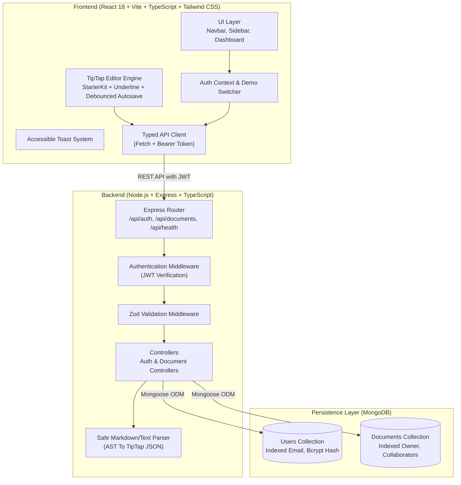
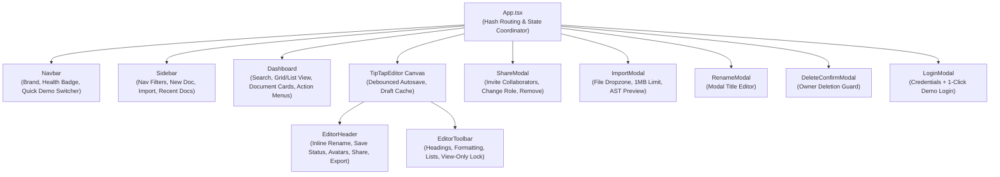

# CollabDocs Architecture & System Design

CollabDocs is an AI-native, lightweight collaborative document editor inspired by Notion, Linear, and Google Docs. It delivers rich-text authoring, robust permission control, persistent storage, and safe file import/export.

---

## 1. High-Level Architecture Diagram

---

## 2. Component Hierarchy & State Management

### State Synchronization Strategy:
- **Editor Content**: Managed directly by TipTap's ProseMirror state. Changes trigger a **1200ms debounced autosave** to the backend.
- **Draft Retention**: In the event of network disruption or backend error, changes remain in client memory (`pendingContentRef`), visual error state is shown (`Retry Save`), and no user draft is lost.
- **URL Hash Routing**: `# /doc/:id` allows direct page refreshes, browser forward/back buttons, and deep linking.

---

## 3. Data Models & Schemas

### User Schema (`User.ts`)
| Field | Type | Attributes | Description |
|---|---|---|---|
| `_id` | ObjectId | Primary Key | Unique user identifier |
| `email` | String | Unique, Indexed, Lowercase | User email address |
| `password` | String | `select: false` | Bcrypt salt & hash (rounds: 10) |
| `name` | String | Required | Full display name |
| `avatarColor` | String | Default: `#7c3aed` | Visual color hex for user avatar initials |
| `createdAt` / `updatedAt` | Date | Timestamps | Audit timestamps |

### Document Schema (`Document.ts`)
| Field | Type | Attributes | Description |
|---|---|---|---|
| `_id` | ObjectId | Primary Key | Unique document identifier |
| `title` | String | Trimmed, Max 200 | Document title (default: "Untitled Document") |
| `content` | Mixed | Schema.Types.Mixed | Structured TipTap ProseMirror JSON tree |
| `owner` | ObjectId | Ref: User, Indexed | Document creator and absolute administrator |
| `collaborators` | Array | Subdocument | List of permitted users with roles |
| `collaborators.user` | ObjectId | Ref: User, Indexed | Collaborator user reference |
| `collaborators.role` | String | `viewer` \| `editor` | Access permission tier |
| `createdAt` / `updatedAt` | Date | Timestamps, Indexed | Document activity timestamps |

**Indexes**:
- `{ owner: 1, updatedAt: -1 }` (Fast owned document lookup)
- `{ 'collaborators.user': 1, updatedAt: -1 }` (Fast shared document lookup)

---

## 4. Role-Based Authorization & Permission Matrix

Authorization is strictly enforced **server-side** on every API endpoint. UI elements (such as disabled toolbars) are merely assistive.

| Action | Owner | Editor | Viewer | Unauthorized / Public |
|---|:---:|:---:|:---:|:---:|
| **Read Document Content** | Yes | Yes | Yes | 403 Forbidden |
| **Edit Document Title / Body** | Yes | Yes | 403 Forbidden | 403 Forbidden |
| **Share Document (Invite User)** | Yes | 403 Forbidden | 403 Forbidden | 403 Forbidden |
| **Change Collaborator Role** | Yes | 403 Forbidden | 403 Forbidden | 403 Forbidden |
| **Remove Collaborator** | Yes | 403 Forbidden | 403 Forbidden | 403 Forbidden |
| **Delete Document** | Yes | 403 Forbidden | 403 Forbidden | 403 Forbidden |
| **Export Document (.md, .txt, .json)** | Yes | Yes | Yes | 403 Forbidden |

---

## 5. REST API Specification

### Authentication
- `POST /api/auth/login` $\to$ Authenticates email/password, returns signed JWT & user profile.
- `GET /api/auth/me` $\to$ Returns current authenticated user profile.
- `GET /api/auth/demo-accounts` $\to$ Returns seeded demo user directory.

### Document Management
- `GET /api/documents?filter=all|owned|shared` $\to$ Lists accessible documents with role metadata.
- `POST /api/documents` $\to$ Creates a new document with initial TipTap structure.
- `POST /api/documents/import` $\to$ Parses raw Markdown / text and creates a structured document.
- `GET /api/documents/:id` $\to$ Retrieves single document (verifies user is owner or collaborator).
- `PATCH /api/documents/:id` $\to$ Updates title or content (owner or editor only).
- `DELETE /api/documents/:id` $\to$ Permanently deletes document (owner only).

### Sharing & Collaboration
- `GET /api/documents/:id/shares` $\to$ Returns collaborator directory (owner & collaborators).
- `POST /api/documents/:id/share` $\to$ Invites or updates collaborator role (owner only).
- `DELETE /api/documents/:id/share/:collaboratorId` $\to$ Removes collaborator (owner only).

### Export & Utility
- `GET /api/documents/:id/export?format=md|txt|json` $\to$ Streams document as downloadable file.
- `GET /api/health` $\to$ Health check with database connection state and uptime.

---

## 6. Explicit Design Choices & Trade-Offs

1. **TipTap Structured JSON vs. Raw HTML / Markdown in DB**:
   - *Choice*: Stored documents as TipTap structured JSON AST (`{ type: 'doc', content: [...] }`).
   - *Advantage*: High fidelity, eliminates XSS attack vectors from raw HTML, preserves exact node attributes across sessions.
   - *Trade-Off*: Requires a parser to convert incoming Markdown/text to TipTap JSON.
2. **Debounced Autosave vs. WebSockets / CRDT**:
   - *Choice*: Debounced HTTP PATCH (1200ms) with client-side retry queue.
   - *Reasoning*: The assessment timebox (4–6 hours) requires rock-solid, production-grade CRUD, role authorization, and stability. Full CRDTs (e.g. Yjs/Automerge) introduce high operational complexity for conflict resolution and state convergence. Debounced autosave provides an intuitive Google Docs/Notion feel while remaining 100% reliable.
3. **Seeded Demo Accounts vs. Open Self-Registration**:
   - *Choice*: Pre-seeded accounts (`alice@example.com`, `bob@example.com`, `charlie@example.com`) with a 1-click switcher.
   - *Advantage*: Guarantees zero friction for reviewers to immediately verify the entire role permission matrix in seconds.

